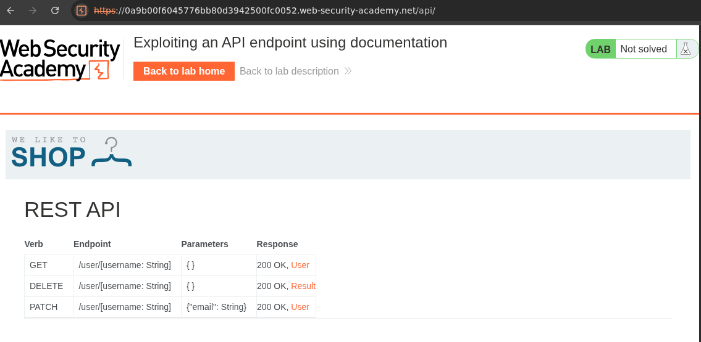
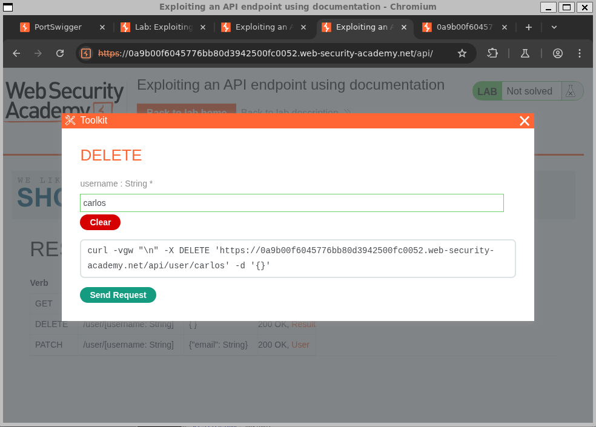
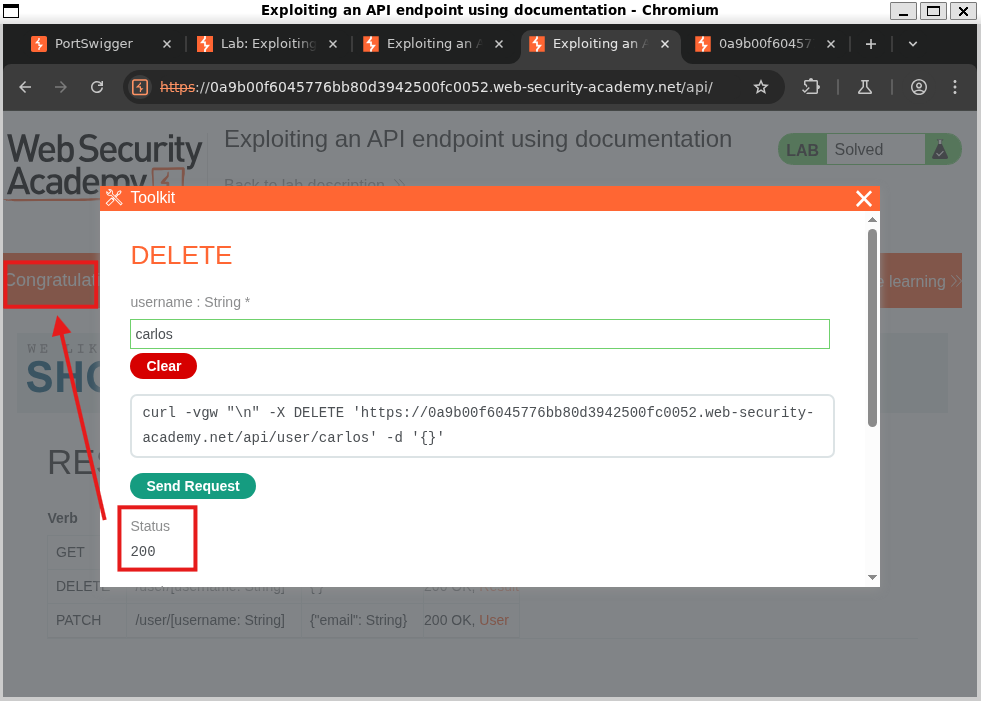

# Exploiting an API endpoint using documentation
>LAB LEVEL: APPRENTICE
## Lab Instructions
To solve the lab, find the exposed API documentation and delete `carlos`. You can log in to your own account using the following credentials: `wiener:peter`.

## Walkthrough
By testing out common endooints in the browser we find the documentation endpoint at 
`https://[lab-number].web-security-academy.net/api/`  

Clicking on the `DELETE` row opens an interactive doc where we can insert the name of the desired delete recipient. 

After sending the request, we recieve a `200 OK` response and complete the lab. 

## Lessons Learned
Intereactive documentation exists and makes API usage easier. 