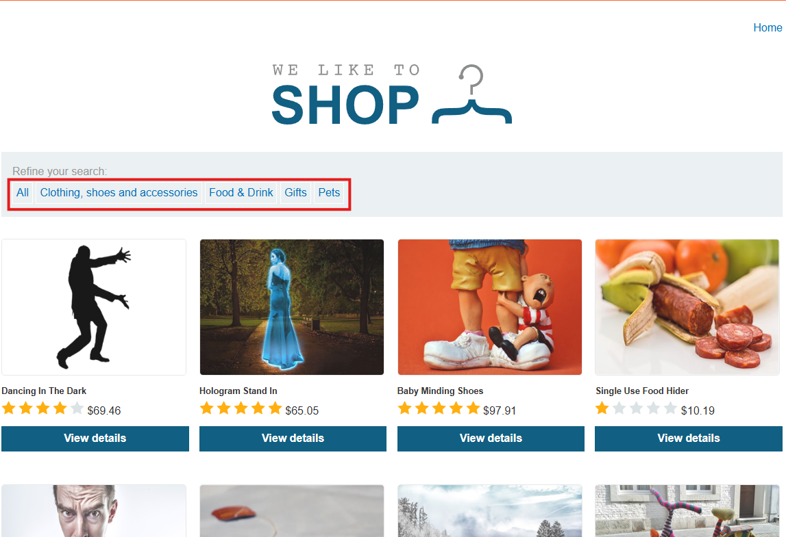
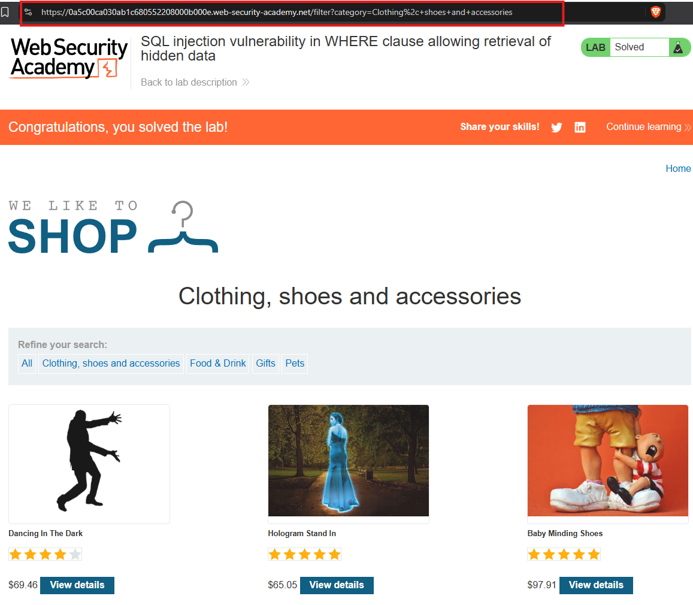
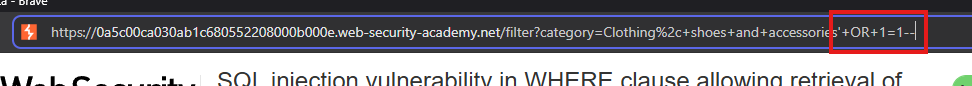
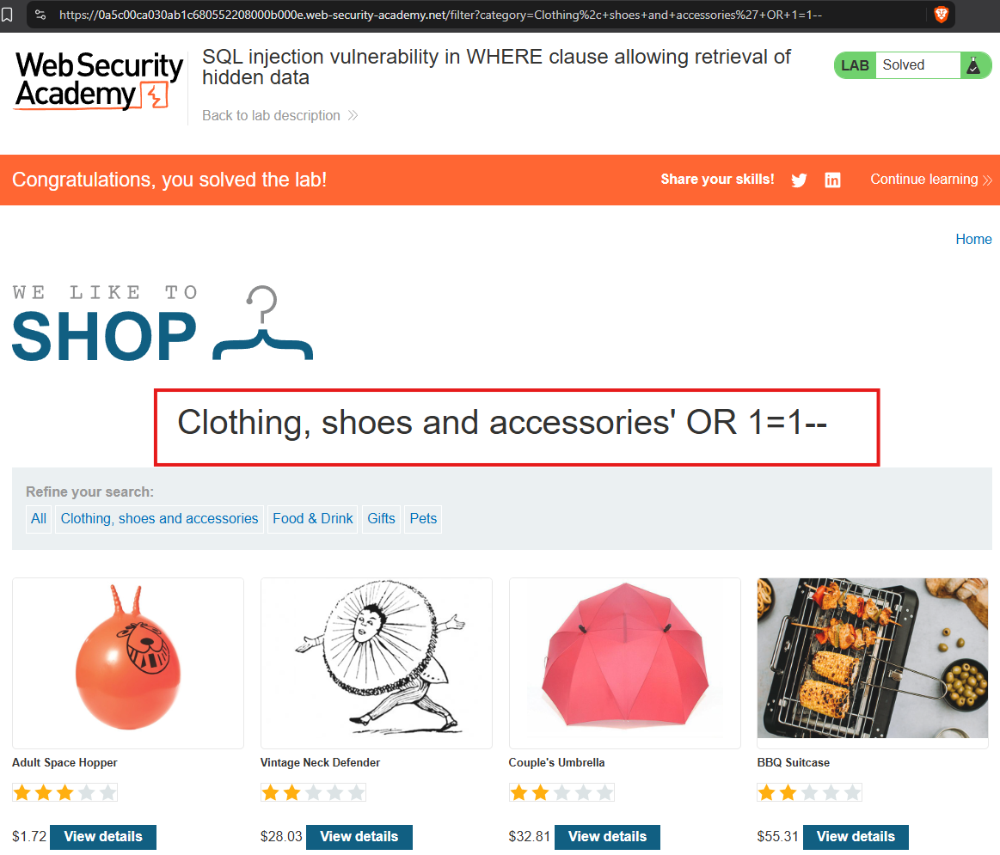

# SQL Injection Vulnerabilty in WHERE clause allowing retrevial of hidden data
## Lab Instructions
This lab contains a SQL injection vulnerability in the product category filter. When the user selects a category, the application carries out a SQL query like the following:

`SELECT * FROM products WHERE category = 'Gifts' AND released = 1`

To solve the lab, perform a SQL injection attack that causes the application to display one or more unreleased products.

## Walkthrough

From the prior instructional section we have the following two examples: 

`'--` AND `'+OR+1=1--`

In the webpage we are presnted with a navigation bar that allows us to select a category:

If we select a category the URL is edited to include the category within the URL:

When can amend the link to include either one of the known SQL injections. 

In the instance of `'+OR+1=1--` we now see the expected unreleased products. 

