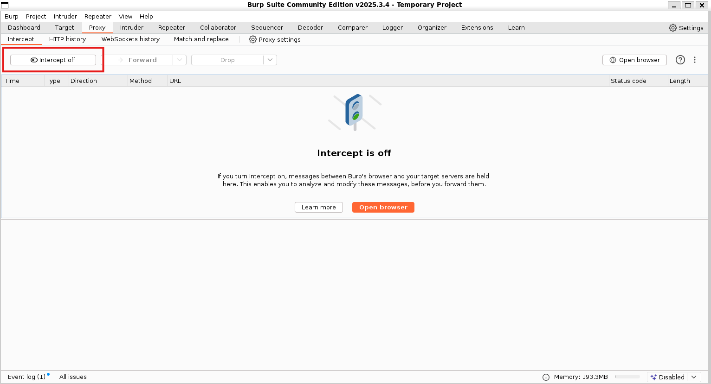
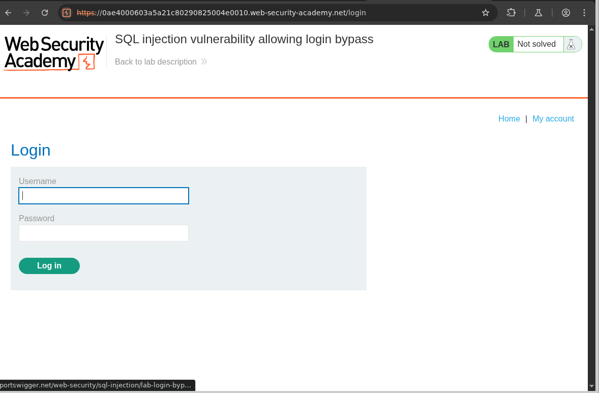
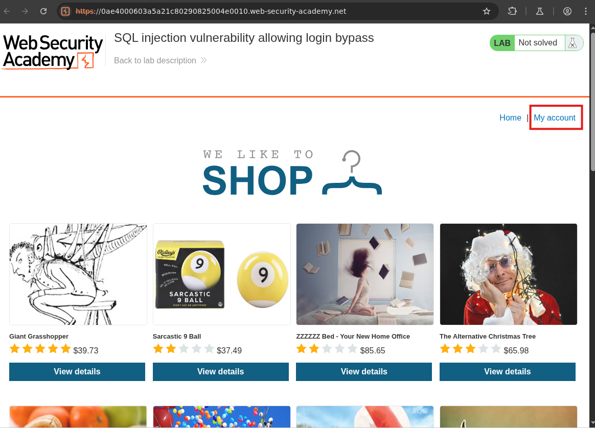
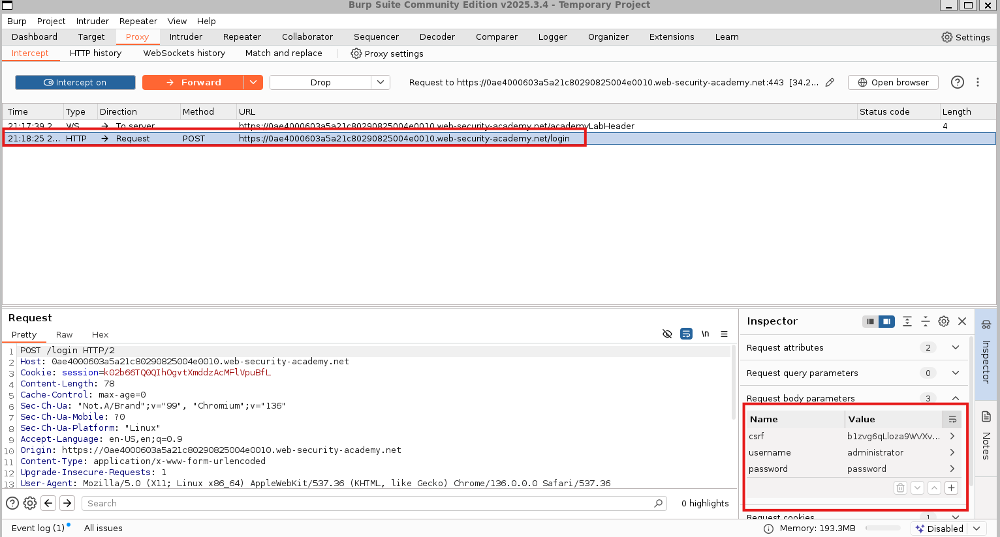

# SQL-002 – SQL injection vulnerability allowing login bypass

## Table of Contents
| Section | Title |
|---|---|
| 1 | [Metadata](#1-metadata) |
| 2 | [Summary](#2-summary) |
| 3 | [Classification](#3-classification) |
| 4 | [Scope & Environment](#4-scope--environment) |
| 5 | [Methodology](#5-methoodology) |
| 6 | [Proof of Concept](#6-proof-of-concept) |
| 7 | [Root Cause](#7-root-cause) |
| 8 | [Impact](#8-impact) |
| 9 | [Remediation](#9-remediation) |
| 10 | [Detection & Response](#10-detection--response) |
| 11 | [Lessons Learned](#11-lessons-learned) |
| 12 | [References](#12-references) |
| [Appendix](#appendix--dead-ends--additional-evidence) | |

## 1. Metadata

| Field | Details |
|---|---|
| Platform | PortSwigger Web Security Academy |
| Lab | [SQL injection vulnerability allowing login bypass](https://portswigger.net/web-security/sql-injection/lab-login-bypass) |
| Difficulty | Apprentice |
| Category | SQL Injection / Authentication Bypass |
| Date | October 29, 2026 |
| Tools | Burp Suite Community Edition |
| Status | Completed |

## 2. Summary

This lab demonstrated a SQL injection vulnerability within an application's login functionality that allowed authentication to be bypassed without knowing the administrator's password.

Using Burp Suite, I intercepted and modified the application's login POST request, injecting SQL syntax into the username parameter. The payload altered the intended SQL query by commenting out the remaining password condition, allowing authentication as the administrator account.

The vulnerability demonstrates how improperly handled user input can compromise authentication controls and provide unauthorized access to privileged accounts.

## 3. Classification

| Classification | Details |
|---|---|
| Weakness | CWE-89: Improper Neutralization of Special Elements used in an SQL Command |
| OWASP Top 10:2025 | A05:2025 – Injection |
| Vulnerability Type | SQL Injection (SQLi) |
| Severity | High |
| CVSS Score | 8.2 – High |
| CVSS Vector | AV:N/AC:L/PR:N/UI:N/S:U/C:H/I:H/A:N* |
| MITRE ATT&CK | T1190 – Exploit Public-Facing Application |

**Severity Note:** The CVSS score and vector are illustrative, based on a hypothetical production application where an unauthenticated attacker can remotely exploit the vulnerability to obtain administrative access. The actual severity would depend on the application's architecture, privileges, exposed data, and potential impact.

**Classification Rationale:**

CWE-89 applies because user-controlled input is interpreted as part of an SQL command rather than being handled exclusively as data.

OWASP A05:2025 covers injection vulnerabilities, including SQL injection.

MITRE ATT&CK T1190 describes exploitation of vulnerabilities in externally accessible applications to obtain initial access. This is a contextual technique mapping rather than a claim that the lab reproduces a complete real-world intrusion.

## 4. Scope & Environment

**Target Environment:**
- Application: We Like to Shop
- Platform: PortSwigger Web Security Academy
- Vulnerable Component: Login functionality
- Target Account: administrator
- Testing Tool: Burp Suite Community Edition

**Scope:**

Testing was limited to the intentionally vulnerable application provided by PortSwigger. No external systems or production applications were targeted.

The objective was to identify and exploit the SQL injection vulnerability to authenticate as the administrator without supplying valid administrator credentials.

## 5. Methodology

### Phase 1: Application Reconnaissance and Request Inspection

The lab presented a simulated shopping application called We Like to Shop.

I reviewed the application and identified the login functionality as the primary testing target.

Burp Suite was used to intercept HTTP traffic and examine the application's requests and parameters.

**Figure 1:** Initial application interface.


**Figure 2:** Login functionality and application navigation.




**Figure 3:** Burp Suite intercepting application traffic.



### Phase 2: Vulnerability Identification

I examined the login request and identified the username and password parameters within the POST request body.

The username parameter was selected as the injection point.

The application appeared to process user-provided login information in a way that allowed SQL syntax to alter the underlying authentication query.

### Phase 3: Exploitation

Using Burp Suite, I modified the username parameter to:

`administrator'--`

The payload was designed to close the existing SQL string and introduce a comment sequence that would exclude the remaining portion of the query, including the password verification condition.

I then forwarded the modified POST request to the application.

**Figure 4:** Modified login POST request containing the SQL injection payload.

Following the successful authentication request, the application generated a subsequent GET request to:

`my-account?id=administrator`

I forwarded the request and was presented with the administrator account interface.

**Figure 5:** Subsequent GET request to the administrator account.

### Phase 4: Verification

The application subsequently presented an interface allowing the administrator account's email address to be updated.

I entered my own email address and forwarded the corresponding request through Burp Suite.

The application displayed a confirmation indicating that the administrator account's email address had been updated.

**Figure 6:** Administrator account email update interface.

**Figure 7:** Successful email update confirmation and lab completion.

These results demonstrated that the injected payload successfully bypassed the login mechanism and provided access to the administrator account.

## 6. Proof of Concept

### Injection Payload

The following payload was submitted through the username parameter:

```sql
administrator'--
```

The password parameter did not need to contain the administrator's actual password.

### Reconstructed SQL Query

The following represents an illustrative reconstruction of the vulnerable SQL query based on the observed behavior. The application's actual backend query and database engine were not independently inspected.

**Original Query (Illustrative):**

```sql
SELECT * FROM users
WHERE username='administrator'
AND password='password';
```

**Query After Injection (Illustrative):**

```sql
SELECT * FROM users
WHERE username='administrator'--'
AND password='';
```

### How the Payload Works

The injection uses two important SQL characters:

| Character | Function |
|---|---|
| `'` | Closes the existing SQL string containing the username. |
| `--` | Introduces an SQL comment, causing the remaining query text to be ignored under the applicable SQL dialect. |

The resulting query effectively removes the password condition from the authentication check.

Instead of evaluating both the username and password, the application evaluates the username condition without enforcing the original password verification.

As a result, the administrator account can be accessed without knowing its password.

**Observed Result:** Successful authentication as the administrator account, followed by access to the administrator profile functionality.

## 7. Root Cause

The underlying weakness is the application's apparent use of user-controlled input in SQL query construction without sufficient separation between SQL commands and input data.

When an application directly incorporates user input into a dynamically constructed SQL statement, specially crafted input can modify the intended query structure.

In this case, the username parameter was interpreted as SQL syntax, allowing the authentication query to be manipulated.

The root cause is consistent with CWE-89: Improper Neutralization of Special Elements used in an SQL Command.

## 8. Impact

Although this exercise was performed in a controlled training environment, a similar vulnerability in a production application could have significant security implications.

**Potential impacts include:**

- **Authentication Bypass:** An attacker could authenticate without possessing valid credentials.
- **Unauthorized Administrative Access:** An attacker could gain access to functionality intended exclusively for privileged users.
- **Account Manipulation:** Administrative profile information, including account-associated email addresses, could potentially be modified.
- **Data Exposure:** Depending on the application's database permissions and query structure, an attacker could potentially retrieve sensitive information.
- **Further Database Compromise:** Other SQL injection techniques could potentially allow unauthorized modification or deletion of database records.

The demonstrated impact was successful administrator authentication and the ability to modify the administrator account's email address.

The additional impacts described above are potential consequences of SQL injection in a production environment, not outcomes independently demonstrated in this lab.

## 9. Remediation

The following measures would help prevent this vulnerability and reduce the potential impact of similar attacks.

### 1. Parameterized Queries / Prepared Statements

Use parameterized queries to ensure user input is treated as data rather than executable SQL syntax.

For example:

```sql
SELECT * FROM users
WHERE username = ?
AND password = ?;
```

The username and password values should be supplied separately through the database driver's parameter-binding functionality.

This prevents specially crafted input from altering the intended SQL query structure.

### 2. Least-Privilege Database Accounts

The application's database account should operate with only the permissions required for its intended functionality.

Avoid granting unnecessary administrative privileges or unrestricted database access to application service accounts.

### 3. Secure Authentication Design

Authentication should use secure password hashing and appropriate account verification mechanisms.

Login functionality should not rely on dynamically constructed SQL statements or allow user input to modify authentication conditions.

### 4. Input Validation

Implement server-side validation to enforce expected input formats and constraints.

Input validation should supplement parameterized queries rather than replace them.

### 5. Generic Error Handling

Avoid exposing database errors, query details, or internal application information to users.

Detailed diagnostic information should be restricted to appropriately protected application logs.

## 10. Detection & Response

SQL injection attempts can be identified through a combination of application logging, database monitoring, web application firewall telemetry, and security testing.

### Potential Detection Indicators

Security teams should monitor for suspicious patterns in authentication requests, including:

- SQL comment sequences such as `--`.
- Unexpected quotation marks within username or password parameters.
- SQL keywords or operators appearing in authentication input.
- Repeated authentication attempts containing malformed or unusual input.
- Successful authentication following suspicious or malformed login requests.
- Unexpected access to administrative account functionality.

**Important:** These indicators are not independently conclusive evidence of SQL injection. Legitimate input can contain special characters, and attackers can use different SQL syntax or encoding techniques to evade simple pattern matching.

### Relevant Log Sources

| Log Source | Information to Investigate |
|---|---|
| Web Server / HTTP Access Logs | Login endpoint requests, request methods, response codes, and request timing. |
| Application Logs | Authentication failures, successful logins, session creation, and account changes. |
| Database Logs | Unusual query execution, query errors, and unexpected database activity. |
| WAF Logs | Requests matching SQL injection detection rules and blocked payloads. |
| Authentication Logs | Unexpected administrator logins and changes to account information. |

### Recommended Detection and Response Actions

1. Investigate suspicious login requests containing potential SQL injection patterns.**  
2. Correlate application and database logs to determine whether the injected input altered query execution.
3. Review successful authentication events following suspicious login requests.
4. Investigate administrative account activity, including profile modifications and privilege changes.
5. If exploitation is confirmed, terminate affected sessions and secure compromised accounts.
6. Review database permissions and application query construction for additional vulnerabilities.
7. Remediate the vulnerable functionality and perform security testing to validate the fix.

## 11. Lessons Learned

This lab provided practical experience using Burp Suite to intercept, inspect, and manipulate HTTP requests during a web application security assessment.

Unlike previous exercises that primarily involved manipulating URL parameters through the browser, this lab required examining and modifying the underlying HTTP request body.

Key takeaways included:

- **HTTP Request Interception:** Practiced using Burp Suite to intercept and modify POST requests before they reached the application.
- **SQL Injection Mechanics:** Improved my understanding of how specially crafted input can alter SQL query structure.
- **Authentication Bypass:** Demonstrated how SQL injection can undermine authentication mechanisms by manipulating query conditions.
- **SQL Comment Syntax:** Learned how SQL comment sequences can be used to exclude portions of an existing query.
- **Request Analysis:** Gained experience examining the relationship between POST requests, subsequent GET requests, and application responses.
- **Security Remediation:** Reinforced the importance of parameterized queries, least-privilege database permissions, and secure authentication design.

The exercise highlighted how vulnerabilities in seemingly simple application functions, such as a login form, can have significant security implications when user input is not handled securely.

## 12. References

- [PortSwigger Web Security Academy – SQL Injection: Login Bypass Lab](https://portswigger.net/web-security/sql-injection/lab-login-bypass)
- [PortSwigger – Burp Suite Community Edition](https://portswigger.net/burp/communitydownload)
- [PortSwigger – SQL Injection](https://portswigger.net/web-security/sql-injection)
- [MITRE CWE-89 – Improper Neutralization of Special Elements used in an SQL Command](https://cwe.mitre.org/data/definitions/89.html)
- [OWASP Top 10:2025 – A05 Injection](https://owasp.org/Top10/2025/A05_2025-Injection/)
- [MITRE ATT&CK – T1190 Exploit Public-Facing Application](https://attack.mitre.org/techniques/T1190/)

## Appendix – Dead Ends / Additional Evidence

### Additional Evidence

The following evidence was collected during the exercise:

- Intercepted login POST request.
- Modified username parameter containing the SQL injection payload.
- Subsequent GET request to the administrator account page.
- Administrator account email update interface.
- Successful email update confirmation.

### Additional Notes

The lab demonstrated the vulnerability through its observable application behavior. The underlying source code and database implementation were not available for direct inspection.

The reconstructed SQL statements are therefore illustrative representations of the likely query behavior rather than verified source-code excerpts.

An original attempt was not shared and additional attack paths were not documented for this exercise.

*CVSS (Common Vulnerability Scoring System) contains eight metrics describing how a vulnerability can be exploited and what impact successful exploitation could have.  

There are two main categories:
1. Exploitability: How difficult is it for an attacker to exploit the vulnerability?
2. Impact: What can happen if the attacker successfully exploits it?

| Abbreviation | Metric | Value | Meaning |
|---|---|---|---|
| AV | Attack Vector | N – Network | The vulnerability can be exploited remotely over a network. |
| AC | Attack Complexity | L – Low | Exploitation does not require special conditions or complicated preparation. |
| PR | Privileges Required | N – None | The attacker does not need an existing account or permissions. |
| UI | User Interaction | N – None | No other user's participation is required to exploit the vulnerability. |
| S | Scope | U – Unchanged | The impact remains within the security authority of the vulnerable component. |
| C | Confidentiality | H – High | Successful exploitation could expose sensitive information. |
| I | Integrity | H – High | Successful exploitation could allow significant unauthorized modification of data. |
| A | Availability | N – None | The vulnerability does not directly affect system availability. |

**Examples:  
**Normal Login**:
```
POST /login HTTP/1.1
Host: example.com
Content-Type: application/x-www-form-urlencoded

username=administrator&password=MyPassword123
```

**Suspicious Login**: 
```
POST /login HTTP/1.1
Host: example.com
Content-Type: application/x-www-form-urlencoded

username=administrator'--&password=test
```

---

*Disclaimer: This findings report documents an authorized PortSwigger Web Security Academy training exercise. All testing was performed within the intentionally vulnerable lab environment.*